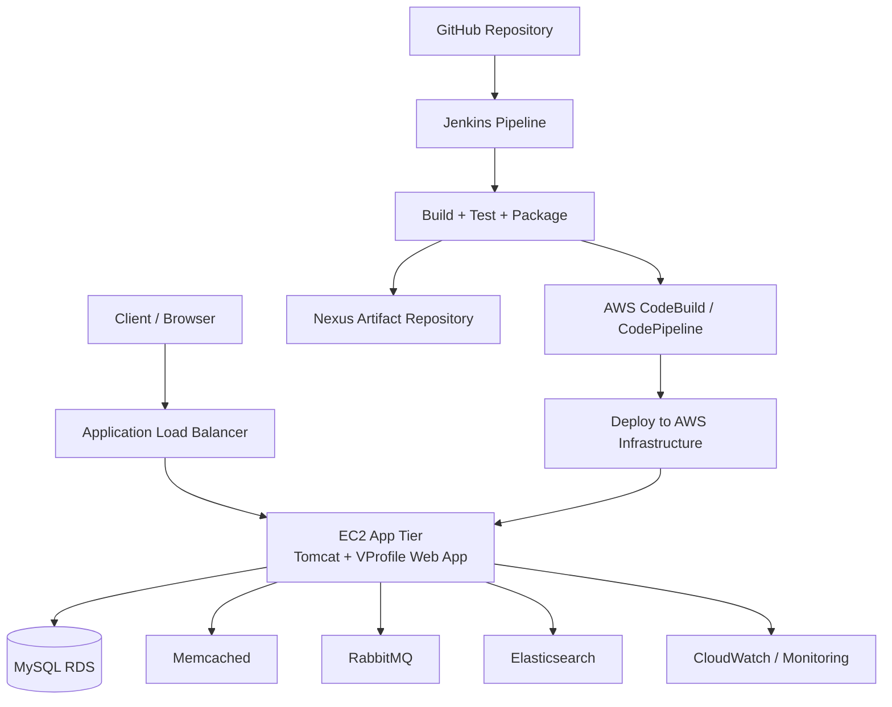

# VProfile Multi-Tier Web Application Deployment on AWS

<p align="center">
  
  
  
  
  
</p>

A production-style deployment project for the VProfile Java web application, designed to run in a multi-tier AWS architecture with automated build, test, and deployment workflows.

This repository contains a full-stack Java web application, deployment automation, infrastructure configuration, and CI/CD pipeline definitions for deploying the app in a scalable and cloud-friendly environment.

## Project Overview

VProfile is a Java web application built using the Spring Framework and a multi-service backend architecture. The application is designed to demonstrate how a real-world web application can be deployed using modern DevOps practices in AWS, including:

- Java web application packaging using Maven
- Multi-tier deployment architecture
- Database and cache integration
- Messaging and search service integration
- CI/CD automation with Jenkins and AWS CodePipeline
- Infrastructure configuration with Ansible and AWS deployment files

## Architecture Diagram



## What This Repository Includes

- Java web application source code for VProfile
- Maven build configuration and dependencies
- Jenkins pipeline for build, test, SonarQube analysis, and artifact publishing
- AWS buildspec configuration for CodeBuild
- Ansible automation for server setup and deployment
- Vagrant-related resources for local experimentation
- Database backup script and app configuration files

## Tech Stack

### Application Layer
- Java 17
- Maven 3
- Spring MVC
- Spring Security
- Spring Data JPA
- JSP / JSTL
- Tomcat

### Data & Messaging Layer
- MySQL
- Memcached
- RabbitMQ
- Elasticsearch

### DevOps & Cloud
- Jenkins
- SonarQube
- Nexus
- AWS CodePipeline
- AWS CodeBuild
- Ansible
- Amazon Web Services (EC2, RDS, ElastiCache, etc. in deployment architecture)

## Repository Structure

```text
.
├── ansible/
│   ├── ansible.cfg
│   ├── site.yml
│   ├── templates/
│   ├── tomcat_setup.yml
│   └── vpro-app-setup.yml
├── aws-files/
│   ├── build_buildspec.yml
│   ├── buildspec.yml
│   ├── sonar_buildspec.yml
│   └── ssh_config_file
├── META-INF/
├── src/
├── vagrant/
├── .gitignore
├── Jenkinsfile
├── README.md
├── pom.xml
├── settings.xml
└── ...
```

## Prerequisites

Before running or deploying the project, make sure you have the following tools installed:

- Java 17+
- Maven 3.9+
- MySQL 8+
- Tomcat (if running manually)
- Git
- Optional: Jenkins, SonarQube, Nexus, AWS CLI, and Ansible for full automation

## Local Setup

### 1. Clone the repository

```bash
git clone https://github.com/dvp2512-d/VProfile-Multi-Tier-Web-Application-Deployment-on-AWS.git
cd VProfile-Multi-Tier-Web-Application-Deployment-on-AWS
```

### 2. Build the project

```bash
mvn clean install -DskipTests
```

### 3. Run the application locally

You can run the app using the Jetty Maven plugin defined in the project or deploy the generated WAR to Tomcat.

```bash
mvn jetty:run
```

Then open the app in your browser:

```text
http://localhost:8080/
```

## Database Setup

The application uses a MySQL database with a dump file located in the project source tree.

```bash
mysql -u <username> -p accounts < src/main/resources/db_backup.sql
```

Make sure your database configuration matches your local DB credentials.

## CI/CD Workflow

This repository includes a Jenkins pipeline that automates:

1. Maven build
2. Unit testing
3. Integration testing
4. Checkstyle validation
5. SonarQube analysis
6. Artifact publishing to Nexus

The pipeline is defined in:

- `Jenkinsfile`
- `aws-files/buildspec.yml`
- `aws-files/build_buildspec.yml`
- `aws-files/sonar_buildspec.yml`

## AWS Deployment Approach

This project is designed for a multi-tier cloud architecture, where each application layer is isolated for better scalability and manageability. In a typical AWS deployment, the architecture can include:

- Application Load Balancer for incoming traffic
- EC2 instances running Tomcat and the VProfile app
- RDS for MySQL database
- ElastiCache / Memcached for in-memory caching
- RabbitMQ for messaging
- Elasticsearch for search capabilities
- CloudWatch for monitoring and logs
- CodePipeline + CodeBuild for automation

## Why This Project Matters

This project demonstrates a realistic DevOps workflow for deploying and managing a Java-based web application in the cloud. It combines:

- application development
- infrastructure automation
- continuous integration
- continuous delivery
- cloud deployment best practices

It is an excellent project for learning:

- Java web application deployment
- AWS architecture design
- CI/CD pipelines
- server configuration automation
- environment-based application deployment

## Notes

This repository contains deployment automation and infrastructure-related files that are intended for learning, experimentation, and hands-on cloud deployment practice.

## Next Steps

To take this project further, you can:

- add Terraform or CloudFormation templates for AWS infrastructure provisioning
- integrate Docker for container-based deployment
- add automated smoke tests in the CI pipeline
- configure a production-grade monitoring and alerting stack
- migrate this to Kubernetes for orchestration

## Useful Commands

```bash
# Build the project
mvn clean package

# Run tests
mvn test

# Start locally with Jetty
mvn jetty:run

# Checkstyle analysis
mvn checkstyle:checkstyle
```

## Final Note

This repository is a strong example of how a traditional Java web application can be modernized for cloud-native deployment with automation, scalability, and CI/CD practices.

If you want, I can also help you with one of the following next:

- create a cleaner deployment architecture diagram for AWS
- generate a Docker setup for this app
- write a Terraform version of the infrastructure
- create a professional `LICENSE` and `CONTRIBUTING.md`
- remove or archive unnecessary files from the repo structure
